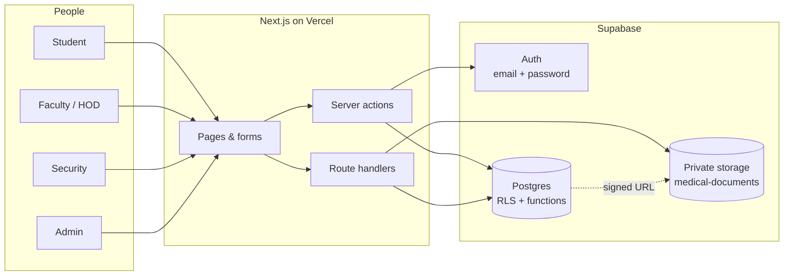
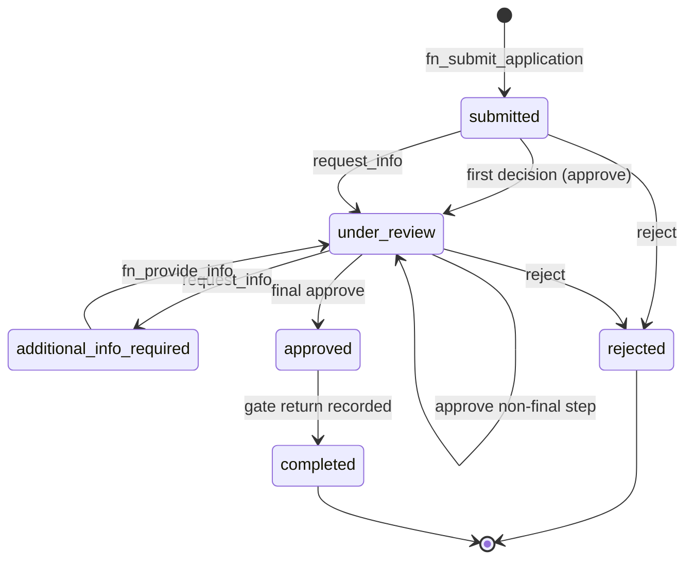
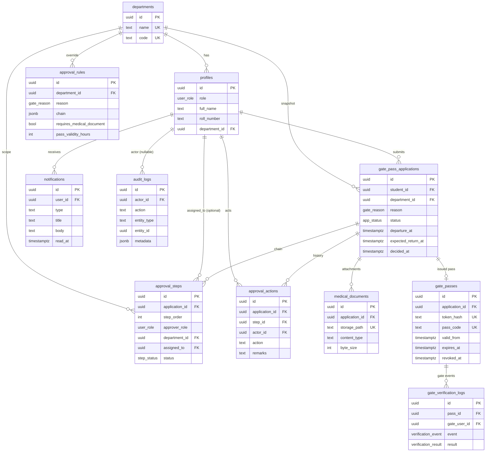
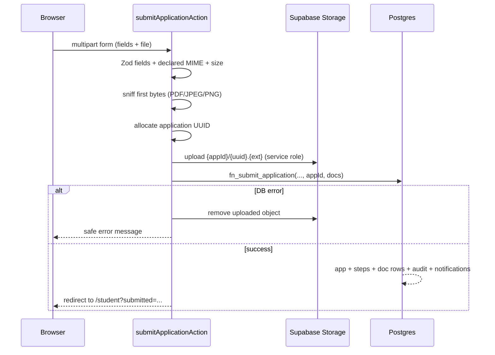

# PROJECT GUIDE — PratapPass

> **What this document is:** a plain-language tour of the codebase. It explains what each module
> does, how a request travels through the system, and which function is responsible for each step.
> It is written for a new contributor who knows some web development but has never seen this repo.
>
> **What this document is not:** the normative schema or API contract. For exact columns, policies,
> and payloads use [`DATABASE.md`](../DATABASE.md), [`API.md`](../API.md), and
> [`SECURITY.md`](../SECURITY.md). This guide points to them at the right moments.

**Status:** all flows described here are implemented and verified locally (T-01 → T-15). Cloud
deployment and email delivery are not implemented; see [Known gaps](#18-known-gaps).

---

## Contents

1. [The one-minute mental model](#1-the-one-minute-mental-model)
2. [The three core objects](#2-the-three-core-objects)
3. [End-to-end sequence](#3-end-to-end-sequence)
4. [Application state machine](#4-application-state-machine)
5. [Who can do what](#5-who-can-do-what)
6. [Repository map](#6-repository-map)
7. [Pages and routes](#7-pages-and-routes)
8. [Server actions](#8-server-actions)
9. [Route handlers (JSON + binary APIs)](#9-route-handlers-json--binary-apis)
10. [Library modules](#10-library-modules)
11. [Components](#11-components)
12. [Database functions, triggers, and helpers](#12-database-functions-triggers-and-helpers)
13. [Data model](#13-data-model)
14. [Validation and the document path](#14-validation-and-the-document-path)
15. [Security model in plain words](#15-security-model-in-plain-words)
16. [Trace a click](#16-trace-a-click)
17. [Testing map](#17-testing-map)
18. [Known gaps](#18-known-gaps)
19. [Glossary](#19-glossary)
20. [Cookbook: where to change what](#20-cookbook-where-to-change-what)

---

## 1. The one-minute mental model

PratapPass is a **workflow application**, not a CRUD dashboard. Three ideas explain almost every
file:

1. **The database is the referee.** A student cannot mark their own request approved, a faculty
   member cannot approve outside their department, and a security guard cannot edit history. These
   rules are enforced in Postgres with row-level security (RLS) and `SECURITY DEFINER` functions,
   not only in the UI.
2. **Next.js renders pages and accepts forms, then asks the database to act.** Server components
   read data through the signed-in user's session (so RLS applies). Server actions validate input,
   call one database function, and translate the result into a redirect or a form error.
3. **Documents never get a public URL.** The private bucket is written by the server only. A
   reviewer clicks *Preview*, the server checks scope, writes an audit row, and redirects to a
   five-minute signed URL.

### System context



### Runtime shape

| Layer | Technology | Responsibility |
|---|---|---|
| UI | React 19 server components + small client components | Render pages, forms, QR, polling |
| HTTP | Next.js 15 App Router | Routing, server actions, route handlers, middleware |
| Validation | Zod 4 | Check every boundary before it reaches SQL |
| Identity | Supabase Auth | Email/password sessions; role lives in `profiles` |
| Authority | Postgres 15 + RLS + `SECURITY DEFINER` | Decide who may read/write what, and which workflow transition is legal |
| Files | Supabase Storage (private bucket) | Medical documents, served only through audited signed URLs |

---

## 2. The three core objects

| Object | Plain meaning | Table |
|---|---|---|
| **Application** | One student's request for a gate pass (reason, departure window, explanation) | `gate_pass_applications` |
| **Approval step** | One seat in the approval chain for that application (faculty first, then HOD, or just one) | `approval_steps` |
| **Gate pass** | The credential issued after final approval; carries the QR token hash and validity window | `gate_passes` |

Supporting objects:

- `approval_actions` — the permanent log of decisions and information requests (append-only).
- `medical_documents` — metadata for uploaded files; bytes live in Storage.
- `notifications` — in-app messages for students and approvers.
- `gate_verification_logs` — every recorded exit/return/rejection by gate staff (append-only).
- `audit_logs` — administrative and security events (append-only).
- `departments`, `profiles`, `approval_rules` — configuration and people.

---

## 3. End-to-end sequence

The happy path for a medical request that needs both faculty and HOD approval:

```mermaid
sequenceDiagram
  autonumber
  actor Student
  participant App as Next.js
  participant DB as Postgres
  actor Faculty
  actor HOD
  actor Security

  Student->>App: Submit form + PDF
  App->>App: Zod + magic-byte checks
  App->>DB: Storage upload (service role)
  App->>DB: fn_submit_application(...)
  DB-->>DB: insert application, steps, doc rows, audit, notifications
  DB-->>Faculty: queue item (RLS: same department)
  Faculty->>App: Preview document
  App->>DB: scope check + audit row
  App-->>Faculty: 307 to 5-minute signed URL
  Faculty->>App: Approve / request info / reject
  App->>DB: fn_decide_application(...)
  DB-->>DB: append action, advance step or pause
  DB-->>HOD: notification when step 2 becomes reachable
  HOD->>App: Final approve
  App->>DB: fn_decide_application(...)
  DB-->>DB: status = approved; trigger fn_issue_pass
  DB-->>Student: pass + notification
  Student->>Security: Shows QR (URL with raw token)
  Security->>App: Open /verify?token=...
  App->>DB: fn_gate_verify(token) [read-only]
  Security->>App: Record exit
  App->>DB: fn_gate_record(token, 'exit')
  Security->>App: Record return
  App->>DB: fn_gate_record(token, 'return')
  DB-->>DB: application = completed
```

Two details that matter:

- **The DB checks the actor again.** The UI may hide a button, but `fn_decide_application` still
  verifies that the caller is the right role in the right department at the right step.
- **Requesting information pauses the chain.** The app becomes `additional_info_required`; the
  student's answer calls `fn_provide_info`, which resumes the same step rather than skipping it.

---

## 4. Application state machine



Emergency requests are created with a single HOD step, so they go
`submitted → under_review → approved` without a faculty step.

The full transition table (including which remarks are required and which actors are rejected) lives
in `DATABASE.md` §6 and is exercised by `tests/fixtures/workflow.sql`.

---

## 5. Who can do what

| Capability | Student | Faculty | HOD | Security | Admin |
|---|---|---|---|---|---|
| Register own account | ✅ | — | — | — | — |
| Submit an application | ✅ own | — | — | — | — |
| Read applications | ✅ own | ✅ same dept | ✅ same dept | — | ✅ all |
| Preview medical documents | ✅ own | ✅ same dept | ✅ same dept | — | ✅ all |
| Decide a step | — | ✅ assigned/dept | ✅ assigned/dept | — | — |
| View own/issued passes | ✅ own | — | ✅ dept | via verify only | ✅ all |
| Verify a pass | ✅ token URL | ✅ token URL | ✅ token URL | ✅ token + code | ✅ token + code |
| Record exit/return/rejection | — | — | — | ✅ | ✅ |
| Manage departments/users/rules | — | — | — | — | ✅ |
| Analytics + audit viewer | — | — | — | — | ✅ |

How to read the table: every ✅ is enforced twice — the page/action checks the role for a clean
redirect, and the database function or RLS policy is the actual authority. The `security` role has
no direct `SELECT` on passes; it gets a minimal holder/window/state payload from
`fn_gate_verify`/`fn_gate_record`.

**Direct entry points after login** (there is no cross-portal nav bar yet):

| Role | Open |
|---|---|
| Student | `/student` |
| Faculty / HOD | `/approver/requests` |
| Security | `/verify` |
| Admin | `/admin` |

---

## 6. Repository map

```text
app/
  (auth)/                 login, register, auth server actions
  student/                dashboard, apply, requests, passes
  approver/               review queue, detail, history, decision action
  admin/                  departments, users, rules, analytics, audit
  verify/                 public QR verification + staff recording action
  api/                    document redirect, QR image, gate verify/record JSON
  layout.tsx              root layout, font, metadata
  page.tsx                landing page (still a placeholder)
  error.tsx               global error boundary
  loading.tsx             global loading skeleton
  not-found.tsx           global 404
  globals.css             theme tokens, table collapse, print rules

components/
  layout/                 shared header/footer
  auth/                   login and registration forms
  student/                application form, status badges, QR card, polling
  approver/               decision panel
  admin/                  admin nav and CRUD forms
  ui/                     shadcn/ui primitives

lib/
  supabase/               browser, server, and service-role clients + generated types
  validation/             Zod schemas shared by forms and actions
  auth/                   redirect sanitizer, admin gate, form state
  admin/                  admin labels, rule parsing, password generation
  gate/                   verify/record wrappers around DB functions
  documents/              magic-byte sniffing
  application/            application form state
  format.ts               IST date/time + byte formatting
  env.ts                  validated environment contract
  utils.ts                className merge helper

supabase/
  migrations/             0001…0016 — schema, RLS, functions, triggers
  seed.sql                synthetic demo data

tests/                    Vitest suites + transactional SQL fixtures
scripts/                  local gate + opt-in dev smoke scripts
docs/                     decision log + this guide
```

---

## 7. Pages and routes

All pages are **server components** unless noted. “Access” describes the runtime guard; the
database still enforces its own rules.

| Route | Access | What it does | Important files |
|---|---|---|---|
| `/` | Public | Landing page; still the T-01 placeholder. Links to login are intentionally absent while unbuilt. | `app/page.tsx` |
| `/login` | Public (redirects signed-in users to `/student`) | Email/password sign-in, honors a sanitized `?next=` path. | `app/(auth)/login/page.tsx`, `components/auth/login-form.tsx` |
| `/register` | Public | Student self-registration with full name, roll number, email, password. | `app/(auth)/register/page.tsx`, `components/auth/register-form.tsx` |
| `/student` | Signed-in; students see their data | Dashboard: summary, five recent applications, notifications, 15-second refresh. Staff see honest empty cards. | `app/student/page.tsx`, `components/student/dashboard-poll.tsx` |
| `/student/apply` | Student | Application form: reason, departure/return, explanation, conditional document input. | `app/student/apply/page.tsx`, `components/student/application-form.tsx` |
| `/student/requests` | Student | Full application history. | `app/student/requests/page.tsx` |
| `/student/requests/[id]` | Student, own row | Timeline, remarks, approval chain, document metadata, info-answer form. | `app/student/requests/[id]/page.tsx`, `.../actions.ts` |
| `/student/passes` | Student | List of issued passes. | `app/student/passes/page.tsx` |
| `/student/passes/[id]` | Student, own pass | QR card, pass details, print/download controls. | `app/student/passes/[id]/page.tsx`, `components/student/qr-pass-card.tsx` |
| `/approver/requests` | Faculty / HOD | Queue of applications with a reachable pending step in the actor's scope. | `app/approver/requests/page.tsx` |
| `/approver/requests/[id]` | Faculty / HOD, scoped | Application detail, history, document preview, decision panel when this actor's step is reachable. | `app/approver/requests/[id]/page.tsx`, `components/approver/decision-panel.tsx` |
| `/approver/history` | Faculty / HOD | The actor's own recorded decisions + processing time. | `app/approver/history/page.tsx` |
| `/admin` | Admin | Redirects to `/admin/departments`. | `app/admin/page.tsx`, `app/admin/layout.tsx` |
| `/admin/departments` | Admin | Department list + create form. | `app/admin/departments/page.tsx` |
| `/admin/departments/[id]` | Admin | Edit + guarded delete (refused while referenced). | `app/admin/departments/[id]/page.tsx` |
| `/admin/users` | Admin | User directory, search/role filter, staff provisioning. | `app/admin/users/page.tsx` |
| `/admin/users/[id]` | Admin | Edit role/department/roll/designation; reset password. | `app/admin/users/[id]/page.tsx` |
| `/admin/rules` | Admin | Global defaults + per-department approval-rule matrix. | `app/admin/rules/page.tsx` |
| `/admin/rules/[id]` | Admin | Edit chain/document requirement/validity; delete overrides only. | `app/admin/rules/[id]/page.tsx` |
| `/admin/analytics` | Admin | KPIs, by-reason and by-department breakdowns, overdue list. | `app/admin/analytics/page.tsx` |
| `/admin/audit` | Admin | Append-only audit viewer with actor/action/date filters and pagination. | `app/admin/audit/page.tsx` |
| `/verify` | Public; recording is staff-only | QR landing page. Shows holder/department/window/exit state only. Staff also see a code-entry form and exit/return/rejection buttons. | `app/verify/page.tsx`, `app/verify/actions.ts` |

**Not present:** `/student/profile`. The route appears in an early draft of `ARCHITECTURE.md` but
was never built; profile self-service is limited to name/phone column grants.

### Layouts and global states

| File | Purpose |
|---|---|
| `app/layout.tsx` | Root HTML shell, Poppins font, metadata. |
| `app/admin/layout.tsx` | Calls `requireAdmin()` once for the whole admin section, renders `AdminNav`. |
| `app/loading.tsx` | Global accessible loading skeleton. |
| `app/error.tsx` | Client error boundary; logs the error in the browser console and offers retry/home. |
| `app/not-found.tsx` | Global 404. |
| `app/globals.css` | MPGI color tokens, responsive table-to-card collapse, reduced-motion handling, print rules, focus rings. |

---

## 8. Server actions

Server actions are the **only** way forms mutate data. Every one follows the same shape:

1. Read the form (or typed arguments).
2. Validate with a shared Zod schema.
3. Call one database function (or one RLS-covered update).
4. Map database errors to user-safe copy, log the real error server-side.
5. `redirect()` or return a typed `{ ok, error, fieldErrors }` state.

| Action | File | Who | Validates | Database call | Result |
|---|---|---|---|---|---|
| `signUpStudent` | `app/(auth)/actions.ts` | Public | `signUpSchema` | `check_roll_number_available`, then `auth.signUp` | Session or form errors; profile row is created by the `handle_new_user` trigger |
| `signIn` | `app/(auth)/actions.ts` | Public | `signInSchema` | `auth.signInWithPassword` | Redirects to sanitized `next` or `/student` |
| `submitApplicationAction` | `app/student/actions.ts` | Student | `applicationSchema`, `documentFileSchema`, magic bytes | Storage upload + `fn_submit_application` | Redirect to the new application; removes the uploaded object if the DB call fails |
| `signOutAction` | `app/student/actions.ts` | Any signed-in | — | `auth.signOut` | `/login` |
| `markNotificationsReadAction` | `app/student/actions.ts` | Signed-in | — | RLS `UPDATE notifications SET read_at` | `/student?notifications=read` |
| `answerAdditionalInfoAction` | `app/student/requests/[id]/actions.ts` | Student | `infoAnswerSchema` | `fn_provide_info` | Redirect back to the application |
| `decideApplicationAction` | `app/approver/actions.ts` | Faculty / HOD | `decisionSchema` | `fn_decide_application` | Redirect to the queue or a refreshed detail page |
| `createDepartmentAction` | `app/admin/departments/actions.ts` | Admin | `departmentSchema` | `fn_admin_create_department` | Form state / redirect |
| `updateDepartmentAction` | `app/admin/departments/actions.ts` | Admin | `departmentSchema` + id | `fn_admin_update_department` | Form state / redirect |
| `deleteDepartmentAction` | `app/admin/departments/actions.ts` | Admin | `departmentIdSchema` | `fn_admin_delete_department` | Redirect with notice, or refusal message |
| `createUserAction` | `app/admin/users/actions.ts` | Admin | `createUserSchema` | `is_admin`, `check_roll_number_available`, GoTrue `createUser`, `fn_admin_create_user` | One-time password panel; compensating rollback if the profile step fails |
| `updateUserAction` | `app/admin/users/actions.ts` | Admin | `updateUserSchema` | `fn_admin_update_user` | Form state / redirect |
| `resetUserPasswordAction` | `app/admin/users/actions.ts` | Admin | `userIdSchema` | GoTrue `updateUserById` + `fn_admin_record_password_reset` | One-time password panel |
| `createRuleAction` | `app/admin/rules/actions.ts` | Admin | `createRuleSchema` | `fn_admin_create_rule` | Form state / redirect |
| `updateRuleAction` | `app/admin/rules/actions.ts` | Admin | `updateRuleSchema` | `fn_admin_update_rule` | Form state / redirect |
| `deleteRuleAction` | `app/admin/rules/actions.ts` | Admin | `ruleIdSchema` | `fn_admin_delete_rule` | Redirect with notice |
| `recordGateEventAction` | `app/verify/actions.ts` | Security / Admin | `gateRecordSchema` | `fn_gate_record` | Redirect with a recorded/error banner |

### Why some actions call two things

- **Submission** uploads first so the file lands on the final opaque path
  (`{application_id}/{uuid}.{ext}`); if `fn_submit_application` fails, the action deletes the object.
  This is why the action allocates the application UUID on the server before the DB call.
- **User creation** must create the GoTrue identity before the profile row. If the profile call
  fails, the action deletes the fresh auth user so a retry does not collide.
- **Password reset** generates a 16-character password, updates GoTrue, then records the audit row.
  If only the audit write fails, the password is still shown with a warning.

### Error-copy pattern

Each action keeps a small allow-list of database `P0001` messages that are safe to show. Anything
else is logged and replaced with a generic fallback, so Postgres internals never reach the browser.
Examples: `app/student/actions.ts` (`friendlySubmitError`), `app/approver/actions.ts`,
`app/admin/rules/actions.ts`.

---

## 9. Route handlers (JSON + binary APIs)

Route handlers exist for things a form action cannot express well: binary responses, redirects to
signed URLs, and programmatic gate APIs.

| Handler | Method | Access | What it does | Response |
|---|---|---|---|---|
| `/api/documents/[id]` | `GET` | Student owner, same-department faculty/HOD, admin | Looks up the document with the service-role client, checks scope explicitly, mints a 300-second signed URL, appends `document.signed_url_issued` **before** redirecting | `307` to the signed URL, or `401/404/500` JSON |
| `/api/passes/[id]/qr` | `GET` | Student owner, admin | Checks scope, calls `fn_pass_qr_token` under the user's session, then renders the QR for `{SITE}/verify?token=…` | SVG by default; `?format=png`; `?download=1` adds an attachment filename; `Cache-Control: no-store` |
| `/api/gate/verify` | `POST` | Anonymous or signed-in | Validates `{ token }` with a strict schema, calls read-only `fn_gate_verify`, returns a minimal pass summary | `{ result, pass }` with `no-store`; never writes a log |
| `/api/gate/record` | `POST` | Security / Admin | Validates `{ token, event }`, pre-checks the role, calls `fn_gate_record` (the authority) | `{ result }` with `no-store`; appends the verification log |

Both gate endpoints return `invalid_token` for unknown probes. Unknown tokens produce **no log row**
because `gate_verification_logs.gate_user_id` is `NOT NULL` and a log must reference a real pass.

### Middleware

`middleware.ts` refreshes the Supabase auth cookie on every eligible request and enforces coarse
session gating:

- `/student`, `/approver`, `/admin` require a signed-in user.
- `/login` and `/register` bounce signed-in users to `/student`.
- **Role** checks are not done here; they live in each page (`requireAdmin`, profile role reads) and,
  ultimately, in Postgres.

---

## 10. Library modules

### 10.1 Supabase clients

| File | Export | What it does |
|---|---|---|
| `lib/supabase/client.ts` | `createSupabaseBrowserClient()` | Anon-key client for client components. Never holds the service-role key. |
| `lib/supabase/server.ts` | `createSupabaseServerClient()` | Cookie-bound server client; reads and RPCs run as the signed-in user, so RLS applies. |
| `lib/supabase/admin.ts` | `createSupabaseAdminClient()` | Service-role client, marked `server-only`; bypasses RLS for narrow operations (storage writes, audited lookups). |
| `lib/supabase/database.types.ts` | `Database`, `Tables`, `Enums`, … | Generated TypeScript types for the schema and RPCs. Regenerate after migrations. |

### 10.2 Environment and formatting

| File | Export | What it does |
|---|---|---|
| `lib/env.ts` | `env` | Parses `NEXT_PUBLIC_SUPABASE_URL`, anon key, optional service key, and site URL at module load; fails fast with a clear message. |
| `lib/format.ts` | `formatInstant`, `formatDate`, `formatBytes` | Formats timestamps in **IST** on the server (avoids hydration drift) and bytes for document listings. |
| `lib/utils.ts` | `cn` | Merges Tailwind class names (shadcn convention). |
| `lib/api/json-error.ts` | `jsonError` | Standard `{ error: { code, message } }` envelope for route handlers. |

### 10.3 Auth helpers

| File | Export | What it does |
|---|---|---|
| `lib/auth/redirect.ts` | `sanitizeRedirectPath` | Accepts only same-origin absolute paths; rejects `//host`, backslashes, and overlong values. Prevents open redirects through `?next=`. |
| `lib/auth/require-admin.ts` | `requireAdmin(nextPath)` | Server gate for `/admin`: anonymous → login with return path; non-admin → `/student`. Returns the Supabase client for the page. |
| `lib/auth/form-state.ts` | `AuthActionState`, `initialAuthState` | Shared shape for login/register form errors. |
| `lib/application/form-state.ts` | `ApplicationActionState`, `initialApplicationState` | Shared shape for the application form. |
| `lib/admin/form-state.ts` | `AdminActionState`, `initialAdminActionState` | Shared shape for admin CRUD forms. |

### 10.4 Validation schemas

| File | Main exports | Boundary it protects |
|---|---|---|
| `lib/validation/auth.ts` | `rollNumberSchema`, `fullNameSchema`, `passwordSchema`, `emailSchema`, `signInSchema`, `signUpSchema` | Registration/login. Normalizes email (trim/lowercase), roll number (uppercase), full name (collapse spaces). Password 8–72 characters. |
| `lib/validation/application.ts` | `DOCUMENT_MAX_BYTES`, `DOCUMENT_ACCEPT`, `reasonSchema`, `applicationSchema`, `documentFileSchema`, `infoAnswerSchema` | Submit form and info answers. Ensures return > departure, explanation 3–2000 chars, file ≤ 4 MiB and declared MIME in the allow-list. |
| `lib/validation/decision.ts` | `decisionSchema` | Approve/reject/request-info; remarks required for the latter two, ≤ 1000 chars. |
| `lib/validation/gate.ts` | `gateProbeSchema`, `gateEventSchema`, `gateRecordSchema`, `gateVerifyRequestSchema`, `gateRecordRequestSchema` | Gate token/code (1–128 chars), event (`exit`/`return`/`rejection`), and strict JSON bodies that reject unknown fields. |
| `lib/validation/admin.ts` | `departmentSchema`, `createUserSchema`, `updateUserSchema`, `createRuleSchema`, `updateRuleSchema`, `auditFilterSchema`, `AUDIT_PAGE_SIZE` | Admin forms and filters. Mirrors the SQL contracts so users get field-level errors before a round trip. |
| `lib/validation/field-errors.ts` | `fieldErrorsFrom` | Converts a Zod error into `{ field: string[] }` for form rendering. |

> **`z.guid()` vs `z.uuid()`:** Zod 4's `uuid()` rejects version-0 UUIDs, but Postgres accepts them
> and the seed/fixtures use them. The repo uses `z.guid()` wherever an id crosses the boundary.

### 10.5 Documents

| File | Export | What it does |
|---|---|---|
| `lib/documents/magic.ts` | `sniffDocumentMime`, `DOCUMENT_EXTENSIONS`, `DocumentMime` | Reads the first bytes and returns `application/pdf`, `image/jpeg`, `image/png`, or `null`. This is the authority, not the browser's claimed `File.type`. |

### 10.6 Gate helpers

| File | Export | What it does |
|---|---|---|
| `lib/gate/results.ts` | `PASS_RESULTS`, `GATE_RESULTS`, `isGateResult` | Single vocabulary for classifications, mirroring the `verification_result` enum. |
| `lib/gate/verify.ts` | `verifyGatePass`, `GateVerification`, `GatePassSummary` | Calls `fn_gate_verify`, validates the returned JSON with Zod, maps snake_case to camelCase. Throws on an unexpected shape — never renders half a pass. |
| `lib/gate/record.ts` | `recordGateEvent`, `GateRecording`, `GatePassRecordSummary` | Calls `fn_gate_record` for security/admin and validates the response. |

### 10.7 Admin helpers

| File | Export | What it does |
|---|---|---|
| `lib/admin/password.ts` | `generatePassword` | 16 chars from an unambiguous alphabet with at least one upper/lower/digit, using `crypto.randomInt`. One-time secret; never stored. |
| `lib/admin/users.ts` | `USER_ROLE_OPTIONS`, `userRoleLabel`, `DepartmentOption`, `AdminUserRecord` | Role labels and which roles require a department; shared by list, filters, and forms. |
| `lib/admin/rules.ts` | `GATE_REASON_OPTIONS`, `RULE_CHAIN_OPTIONS`, `gateReasonLabel`, `ruleChainLabel`, `parseRuleChain`, `AdminRuleRecord` | Rule labels and safe parsing of the stored JSON chain into a supported preset. Unsupported shapes are shown as such rather than silently rewritten. |

### 10.8 Upload path (why the server does it)

The browser never receives a Storage write credential:

1. `submitApplicationAction` allocates a UUID.
2. It reads only the first bytes to sniff the type and checks the 4 MiB cap.
3. It uploads with the **service-role** client to `medical-documents/{applicationId}/{uuid}.{ext}`.
4. It calls `fn_submit_application` with the document metadata and the pre-allocated id.
5. If the DB call fails, it removes the uploaded object.

The bucket itself has a 4 MiB limit and a MIME allow-list, and `medical_documents.byte_size` has a
matching CHECK. Three layers, one number.

---

## 11. Components

### Layout

| Component | Type | Purpose |
|---|---|---|
| `AppHeader` | Server | Brand bar, skip link, optional right-side action. |
| `AppFooter` | Server | Institutional footer. |

### Auth

| Component | Type | Purpose |
|---|---|---|
| `LoginForm` | Client | Email/password form with `useActionState`, field errors, and a hidden sanitized `next`. |
| `RegisterForm` | Client | Student signup form; roll number, name, email, password. |

### Student

| Component | Type | Purpose |
|---|---|---|
| `ApplicationForm` | Client | Reason selector, native datetime inputs converted to ISO, conditional file input, client-side size/type hints, server errors. |
| `ProvideInfoForm` | Client | Answer an information request (1–2000 chars). |
| `DecisionPanel` | Client (approver folder) | Approve / request info / reject radios + remarks; only mounted when the viewer can act. |
| `DashboardPoll` | Client | Re-reads the dashboard every 15 seconds with `router.refresh()`, paused while the tab is hidden. |
| `QrPassCard` | Client | QR image, print button, PNG/SVG download links. |
| `StatusBadge` | Server | Maps application status to a labelled badge. |
| `StepBadge` | Server | Maps approval-step status to a badge. |
| `REASON_LABELS`, `STEP_ROLE_LABELS`, `ACTION_LABELS` | Constants | Shared human-readable labels. |

### Approver

| Component | Type | Purpose |
|---|---|---|
| `DecisionPanel` | Client | The only approval UI; renders remarks only for reject/request-info. |

### Admin

| Component | Type | Purpose |
|---|---|---|
| `AdminNav` | Client | Section switcher; highlights the active route. |
| `DepartmentForm` | Client | Create/edit department. |
| `DepartmentDelete` | Client | Guarded delete with confirmation. |
| `RuleForm` | Client | Create/edit approval rule; chain presets, document flag, validity. |
| `RuleDelete` | Client | Delete a department override. |
| `UserCreateForm` | Client | Role-adaptive provisioning form. |
| `UserEditForm` | Client | Edit profile fields. |
| `UserFields` | Client | Shared role/department/roll/designation inputs. |
| `UserPasswordResetForm` | Client | Reset a user's password and show the one-time result. |
| `GeneratedPassword` | Client | One-time password panel with copy affordance and warning. |
| `AdminFormMessage` | Server | Renders top-level action errors/success. |

### UI primitives

`components/ui/` contains the shadcn/ui building blocks: `badge`, `button`, `card`, `dialog`,
`input`, `label`, `select`, `table`, `tabs`, `textarea`. They are presentation-only; business rules
do not live here. (`dialog` and `tabs` are installed but not currently imported.)

---

## 12. Database functions, triggers, and helpers

There are three kinds of SQL callables in this project:

- **Workflow functions** — `SECURITY DEFINER`, called from server actions through `supabase.rpc`.
  They re-check the caller and own the state transitions.
- **Read helpers** — used by RLS policies (e.g. `is_admin()`) or by pages for scoped reads.
- **Trigger functions** — run automatically on inserts/updates.

### 12.1 Workflow + gate functions

| Function | Called by | Plain-language job |
|---|---|---|
| `fn_submit_application(reason, departure, expected_return, explanation, docs, application_id?)` | Student action | Creates the application, validates the window/rule/document, builds the approval steps (emergency → single HOD step), writes audit + notifications. |
| `fn_decide_application(application_id, action, remarks)` | Approver action | Verifies the actor is the reachable step's approver, appends an `approval_actions` row, advances/pauses/rejects the application, notifies the next actor or student. |
| `fn_provide_info(application_id, text)` | Student action | Only while `additional_info_required`; resumes the paused step and returns the app to `under_review`. |
| `fn_issue_pass(application_id)` | Trigger on `approved` | Creates exactly one pass, derives the token HMAC, sets `pass_code`, validity, notification, and audit. Not executable by clients. |
| `fn_pass_qr_token(pass_id)` | QR route | Re-derives the raw token inside the DB for the owning student or an admin; verifies the digest against `token_hash`; fails loudly on secret rotation. |
| `fn_gate_verify(token_or_code)` | `/verify`, `/api/gate/verify` | Read-only classification. Anonymous callers may use the raw token only; security/admin may use `MPGI-*` codes. Returns holder/department/window/exit state, never reason or documents. |
| `fn_gate_record(token_or_code, event)` | `/verify` action, `/api/gate/record` | Security/admin only. Appends a verification log, classifies the attempt, and completes the application on a valid return. |
| `fn_mark_notifications_read(ids)` | *Unused* | Exists in migration 0005 but the app uses a direct RLS-covered `UPDATE ... SET read_at`; a definer function adds no authority here. |

### 12.2 Admin functions

All are `SECURITY DEFINER`, check `is_admin() is not true` (fail closed), set
`search_path = public`, and revoke `EXECUTE` from `anon`/`public`.

| Function | Job |
|---|---|
| `fn_admin_create_department`, `fn_admin_update_department`, `fn_admin_delete_department` | Audited department CRUD; delete refuses while profiles/applications/steps/rules reference it (no cascade). |
| `fn_admin_list_users(search?, role?, user_id?)` | Directory listing joined to `auth.users` for email, capped at 100 rows + total count. |
| `fn_admin_create_user(...)` | Validates role-inappropriate fields, inserts the profile for an already-created GoTrue user, audits. |
| `fn_admin_update_user(...)` | Advisory-locked update; refuses self-role changes, last-admin demotion, approvers with pending steps, students with in-flight applications. |
| `fn_admin_record_password_reset(user_id)` | Records the administrative reset in the audit log (the password itself is handled by GoTrue). |
| `fn_admin_list_rules(rule_id?)`, `fn_admin_create_rule(...)`, `fn_admin_update_rule(...)`, `fn_admin_delete_rule(...)` | Audited rule CRUD; immutable `(department, reason)` key; global defaults cannot be deleted; emergency is always `["hod"]`. |
| `fn_admin_analytics()`, `fn_admin_analytics_breakdown()` | Read-only KPIs and reason/department breakdowns. |
| `fn_admin_list_audit(...)`, `fn_admin_audit_actors()` | Read-only audit search with literal prefix matching, inclusive dates, limit clamp, total count. |

### 12.3 Read helpers and triggers

| Function | Kind | Job |
|---|---|---|
| `handle_new_user()` | Trigger on `auth.users` | Creates the matching `profiles` row (always `student`) when a student signs up. |
| `touch_updated_at()` | Trigger | Maintains `updated_at` columns. |
| `forbid_history_mutation()` | Trigger | Raises on UPDATE/DELETE for `approval_actions`, `gate_verification_logs`, and `audit_logs`. |
| `on_application_approved()` | Trigger on application status | Calls `fn_issue_pass` exactly once when an application becomes `approved`. |
| `check_roll_number_available(candidate)` | RPC | Case-insensitive availability check used by registration and admin provisioning. |
| `get_user_role(uid)`, `get_user_department(uid)`, `is_admin()` | RLS helpers | Look up the caller's role/department without recursive policy loops. |
| `private.assert_department_fields`, `private.assert_rule_fields`, `private.normalize_user_fields` | Internal | Shared validation used by the admin functions. |

`private` is not exposed through PostgREST; only `public` functions are callable via the API.

### 12.4 The QR token model

```text
raw token  = HMAC-SHA256(secret, pass_id)      ← never stored
token_hash = SHA-256(raw token)                ← stored in gate_passes
QR URL     = https://site/verify?token=<raw>   ← what the student shows
```

- The secret lives in `private.app_secrets`, which client roles cannot read and PostgREST does not
  expose.
- `fn_issue_pass` computes the hash; `fn_pass_qr_token` recomputes the raw token on demand.
- Revocation is a column (`revoked_at`), so a pass can be invalidated without changing the token.
- The QR route answers `404` for both unknown and out-of-scope pass ids — no existence oracle.

---

## 13. Data model



`approval_rules.department_id` is nullable: `NULL` means the global default, a value means that
department's override. The unique key is `(department_id, reason)` with `NULLS NOT DISTINCT`.

### Table roles at a glance

| Table | One-line purpose | Append-only? |
|---|---|---|
| `departments` | Academic departments and their codes | — |
| `profiles` | One row per auth user: role, name, roll, department, designation | — |
| `gate_pass_applications` | The request itself + status + decision timestamps | — |
| `approval_steps` | The chain: who must act, in what order | — |
| `approval_actions` | Immutable decision/info history | ✅ |
| `medical_documents` | Metadata for private files | — |
| `gate_passes` | Issued credential metadata (hash, code, window) | — |
| `gate_verification_logs` | Every recorded gate event | ✅ |
| `notifications` | In-app messages; only `read_at` is mutable by the user | — |
| `audit_logs` | Administrative/security event trail | ✅ |
| `approval_rules` | Chain + document + validity configuration | — |

Full columns, indexes, and policies: [`DATABASE.md`](../DATABASE.md) §2–§4.

---

## 14. Validation and the document path

### Boundaries where validation happens

| Boundary | Schema / check | What happens on failure |
|---|---|---|
| Login / register form | `lib/validation/auth.ts` | Field-level form errors |
| Application form | `lib/validation/application.ts` | Field-level errors; no upload attempted |
| File bytes | `lib/documents/magic.ts` + declared MIME + size | Rejected before upload |
| Approver decision | `lib/validation/decision.ts` | Field errors / safe database message |
| Gate verify/record JSON | `lib/validation/gate.ts` (strict) | `400 invalid_request` |
| Admin forms | `lib/validation/admin.ts` | Field-level errors |
| Every DB function | SQL checks | `P0001` with user-actionable text, mapped by the action |

### The upload sequence



Preview path for staff:

```text
/approver/requests/[id] → Preview link
→ GET /api/documents/[id]
→ session user + role + department checked explicitly
→ audit row appended (fails closed if it cannot write)
→ 307 to a 300-second signed Storage URL
```

The browser never sees a bucket credential, and the URL expires quickly.

---

## 15. Security model in plain words

| Layer | Question it answers | Where |
|---|---|---|
| Authentication | “Who is this?” | Supabase Auth session cookie |
| Coarse routing | “Is this request signed in?” | `middleware.ts` |
| Page guard | “Should this role see this screen?” | `requireAdmin`, page-level role reads |
| Row-level security | “Which rows may this session read/write?” | Policies in `supabase/migrations/0004` + `0009` |
| Workflow authority | “Is this transition legal for this actor?” | `SECURITY DEFINER` functions |
| Storage authority | “May these bytes be served, and for how long?” | `/api/documents/[id]` + service-role signed URL |
| Audit | “Who did what, and can it be changed?” | Append-only `audit_logs`, `approval_actions`, `gate_verification_logs` |

### Threat-model highlights

- **Role escalation:** `profiles.role` is not client-writable. RLS + column grants restrict
  self-updates to name/phone; role/department/roll changes go through audited admin functions.
- **Cross-department snooping:** faculty/HOD reads are scoped by `department_id`. The approver queue
  also filters to the minimum reachable pending step so an HOD cannot act early.
- **Document leaks:** no public bucket, no client write policy, opaque paths, server-mediated
  uploads, short-lived signed URLs, audit-before-redirect.
- **QR forgery/enumeration:** 256-bit HMAC token; only its SHA-256 is stored; anonymous callers can
  use tokens but not the 24-bit human code; unknown probes do not create logs.
- **History rewriting:** triggers raise on UPDATE/DELETE for the three append-only tables, even for
  the table owner.
- **Open redirects:** `?next=` is sanitized to a same-origin path.
- **Error leakage:** actions allow-list safe messages and log the rest server-side.

### Intentional trade-offs

- Anonymous verification is read-only and unlogged (no `gate_user_id`); recording requires staff.
- Late returns are accepted after a valid exit (stranding a returning student is worse than a late
  timestamp).
- Admins can read all documents; every fetch is audited.
- No email delivery yet — in-app notifications only.

---

## 16. Trace a click

### A. Student submits an application

1. `app/student/apply/page.tsx` renders `ApplicationForm` after checking the session and
   `profile.role === "student"`.
2. `ApplicationForm` converts the two `datetime-local` values to ISO strings in the browser and
   posts to `submitApplicationAction`.
3. `app/student/actions.ts` parses the fields, checks the file’s declared MIME/size, sniffs the
   magic bytes, allocates a UUID, and uploads with the service-role client.
4. It calls `supabase.rpc("fn_submit_application", …)` under the **user's** session.
5. The function checks the role, departure window, rule, and document requirement; inserts the
   application, steps, and document metadata; writes audit + notification rows.
6. The action redirects to `/student?submitted=…`; the dashboard’s `DashboardPoll` will refresh.

### B. Faculty approves

1. `/approver/requests` reads applications where the user can reach the lowest pending step.
2. `/approver/requests/[id]` loads the application, chain, actions, and documents; it renders
   `DecisionPanel` only if the reachable step matches the viewer.
3. `DecisionPanel` posts to `decideApplicationAction`.
4. `app/approver/actions.ts` validates with `decisionSchema` and calls `fn_decide_application`.
5. The function re-checks role/department/step, appends `approval_actions`, advances the step or
   pauses for info, updates the application status, and notifies the next actor/student.
6. On the final approval, the `on_application_approved` trigger calls `fn_issue_pass`.

### C. Security verifies and records a gate event

1. The student opens their pass page; `QrPassCard` requests `/api/passes/[id]/qr`.
2. The route checks ownership, calls `fn_pass_qr_token`, and renders the QR for
   `/verify?token=<raw>`.
3. Security scans the QR; `/verify` calls `fn_gate_verify` (read-only) and shows holder, department,
   window, and exit state.
4. Security presses **Record exit**; `recordGateEventAction` or `/api/gate/record` calls
   `fn_gate_record`.
5. The function appends a `gate_verification_logs` row, classifies the attempt, and on a valid return
   sets the application to `completed`.

---

## 17. Testing map

### Automated (Vitest + real Postgres)

| File | Focus |
|---|---|
| `tests/validation.test.ts` | Document sniffing, size boundaries, MIME allow-list, application/answer/gate schemas, strict JSON bodies |
| `tests/rls.test.ts` | Five roles × eleven tables; scoped vs foreign sentinels; anonymous sees nothing; direct writes/role escalation denied |
| `tests/workflow.test.ts` + `tests/fixtures/workflow.sql` | Full happy path and denial probes at each transition |
| `tests/qr-verify.test.ts` + `tests/fixtures/qr-verify.sql` | Token derivation, digest round-trip, anonymous/code restrictions, minimal payload, revoked/expired/exited/returned classifications |

Every write fixture runs inside a transaction that is rolled back, so tests never mutate the demo
data. Run:

```bash
./scripts/test.sh          # typecheck + lint + tests
npm run build              # production build
```

Requirements: a running local Supabase stack, a seeded database, and `psql` on `PATH`.
`SUPABASE_DB_URL` overrides the default connection string.

### Manual / evidence scripts (`scripts/dev/`)

These are opt-in scripts used during development to exercise real sessions and HTTP routes. They are
not part of `npm run test` because they need a running app, Chrome, and seeded users.

| Script | What it demonstrates |
|---|---|
| `seed-login-check.mjs` | All five demo identities can sign in |
| `signup-demo.mjs` | Student signup + roll availability |
| `apply-smoke.mjs` | Upload + submit + RLS read |
| `track-smoke.mjs` | Info request → answer → resubmit visibility |
| `approver-smoke.mjs` | Queue scoping + audited document preview |
| `decision-smoke.mjs` | Approve/reject/request-info + pass issuance |
| `pass-smoke.mjs` | QR render + machine decode |
| `gate-smoke.mjs` | Verify/record classifications + completion |
| `admin-*-smoke.mjs`, `admin-rules-e2e.mjs`, `admin-users-provision.mjs` | Admin CRUD, rules, provisioning, analytics/audit reconciliation |
| `ux-smoke.mjs` | Responsive layout, touch targets, empty states, skip link |

There are **no component tests** by decision (D-024); UI behavior is covered by these smoke scripts.
If you add a workflow rule, add a denial probe to the SQL fixture — an assertion that the forbidden
action fails is as important as the happy path.

---

## 18. Known gaps

| Gap | Why it matters | Where tracked |
|---|---|---|
| Cloud deployment not configured | The app runs locally only | KI-002 |
| Landing page is a placeholder | `/` still says “In development — T-02 auth live” | `app/page.tsx` |
| No cross-portal navigation | Staff sign in to `/student`; faculty/security must open their portal URL directly | KI-017 |
| No email delivery | Decisions only appear in-app | KI-003 |
| No user deactivation | Departing staff keep access until removed manually | KI-015 |
| Password reset keeps old sessions | Reset is credential recovery, not incident response | KI-016 |
| No rate limiting | Public verify/submit endpoints need a limiter before production | KI-009 |
| Apply form is reason-driven | Rule/document mismatches surface only at submit time | KI-013 |
| Rejected chain leaves stale queue row | A later approver can see a rejected request with no possible action | KI-019 |
| Next 15/postcss advisory | Build-time CSS only; fix path is a Next 16 upgrade | KI-014 |
| No component tests | UI regressions rely on smoke scripts | D-024 |

---

## 19. Glossary

| Term | Meaning here |
|---|---|
| **RLS** | Row-Level Security: Postgres policies that filter which rows a session can see or change. |
| **SECURITY DEFINER** | A Postgres function that runs with its owner's privileges; used to perform a workflow transition after checking the caller explicitly. |
| **RPC** | A function called through Supabase/PostgREST (`supabase.rpc("fn_…")`). |
| **Service role** | A Supabase key that bypasses RLS. Server-only; never sent to the browser. |
| **Signed URL** | A time-limited URL that grants access to one private Storage object. |
| **JWT claims** | Identity data carried by the Supabase session; tests set these manually to simulate roles. |
| **HMAC** | Keyed hash used to derive the QR token deterministically from a pass id. |
| **Pass code** | Human-readable `MPGI-XXXXXX` identifier; not sufficient for anonymous verification. |
| **Reachable step** | The lowest pending step in a chain; only that step's approver may act. |
| **Append-only** | Rows can be inserted and read but never updated or deleted. |
| **IST** | India Standard Time (`Asia/Kolkata`), used for all displayed timestamps. |
| **Opaque path** | A storage path containing ids/UUIDs rather than names or roll numbers. |

---

## 20. Cookbook: where to change what

| I want to… | Start here |
|---|---|
| Change a label or status color | `components/student/status-badge.tsx`, `lib/admin/rules.ts`, `lib/admin/users.ts` |
| Change the approval chain or document requirement | Admin UI → Rules (no code); fallback SQL: `approval_rules` |
| Change pass validity | Admin rule `pass_validity_hours` (1–720) |
| Change the upload cap or accepted types | `lib/validation/application.ts`, `supabase/migrations/0007`, `0008` (new migration) |
| Change brand colors or fonts | `app/globals.css`, `app/layout.tsx`, `DESIGN_SYSTEM.md` |
| Add a field to applications | Migration + `DATABASE.md` + generated types + `fn_submit_application` + Zod + form + detail pages + tests |
| Add a new role | Enum migration + RLS matrix + every page guard + functions + admin UI + tests (large, decision-worthy) |
| Add a new admin section | Route under `app/admin/`, add to `components/admin/admin-nav.tsx`, add a read function if it needs data |
| Add a new API endpoint | `app/api/…/route.ts`, validate with Zod, return the `jsonError` envelope, document in `API.md` |
| Add a workflow transition | New migration with a `SECURITY DEFINER` function + audit/notification + denial tests |
| Rotate the QR secret | Provision a new value in `private.app_secrets`; existing passes will fail the digest check loudly (by design) |

### Before you open a PR

1. Run `./scripts/test.sh` and `npm run build`.
2. Add or update a denial probe if you touched a workflow rule.
3. Update `TASKS.md`, `KNOWN_ISSUES.md`, and the relevant doc.
4. Never commit `.env*`, secrets, or real student data.
5. Keep the diff focused; this repo values small, reviewable changes.
